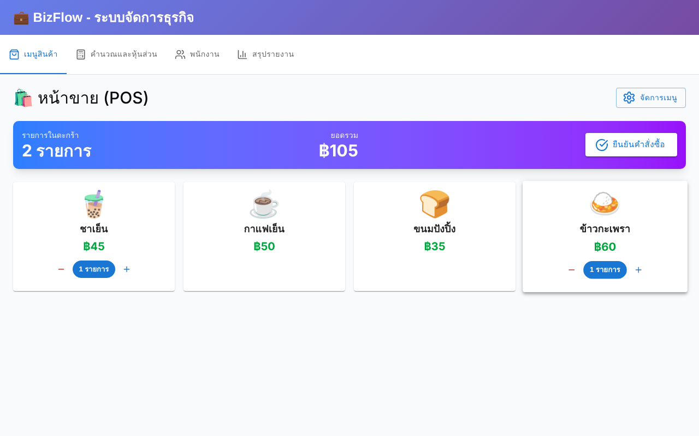
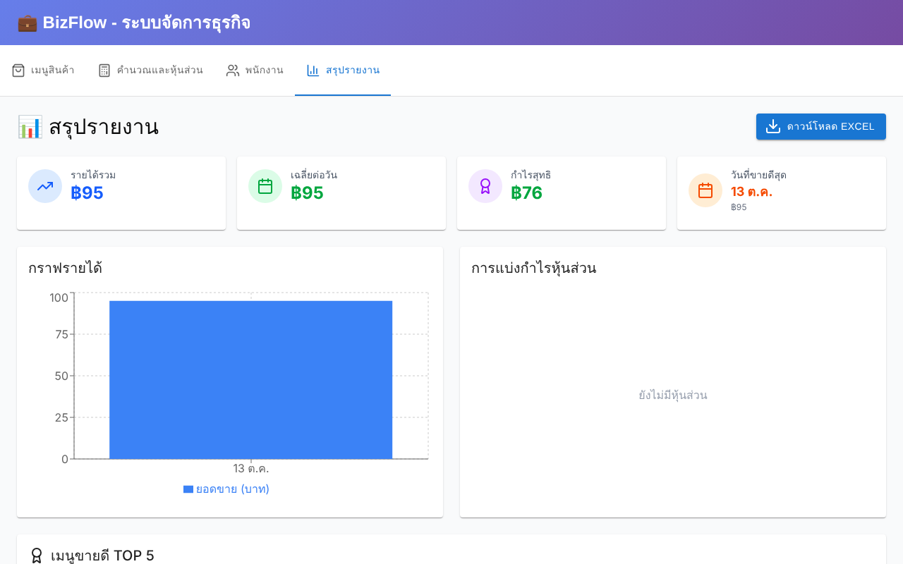

# BizFlow Web — Small-Business POS & Profit Sharing

**A web app for small food and drink businesses: sell from a POS screen, track daily sales, calculate costs and staff wages, split profit between partners, and export reports to Excel. Data is saved in the browser.**


> Front-end prototype of the BizFlow idea, designed in Figma ([design file](https://www.figma.com/design/eHhnqTvZmdVf6e85Scmu3w/BizFlow-Web-Application)). The full-stack version with QR ordering and a real database is [bizflow-monorepo-demo](https://github.com/tawan230666/bizflow-monorepo-demo).

| POS | Reports |
|---|---|
|  |  |

## Features

| Page | What it does |
|---|---|
| **POS (เมนูสินค้า)** | Tap items to build an order, adjust quantities and confirm the sale; manage the menu (name, price, emoji/image) |
| **Costs & partners (คำนวณและหุ้นส่วน)** | Custom monthly costs, reinvestment percentage, and partners with profit-share percentages |
| **Employees (พนักงาน)** | Staff with daily, monthly or yearly pay, normalised to a daily cost |
| **Reports (สรุปรายงาน)** | Revenue, daily average, net profit, best day, revenue chart, partner split, top-5 items, **Excel export** |

## Implementation notes

- **Shared state** in a typed React Context (`BusinessContext`); every page reads and writes through it
- **Persistence:** a small `usePersistentState` hook saves each slice to `localStorage`, so data survives reloads; a demo menu is seeded on the first visit
- **Correct sales tallies:** each order adds its quantities to the day's per-item counts exactly once
- UI built from shadcn/ui and MUI components, with Recharts for charts

## Run

```bash
git clone https://github.com/tawan230666/Product.git
cd Product
npm install
npm run dev
```

---

**Author:** Tawan Tiphkun (ธาวัน ทิพคุณ), [@tawan230666](https://github.com/tawan230666), Software Engineering, RMUTL Chiang Mai
